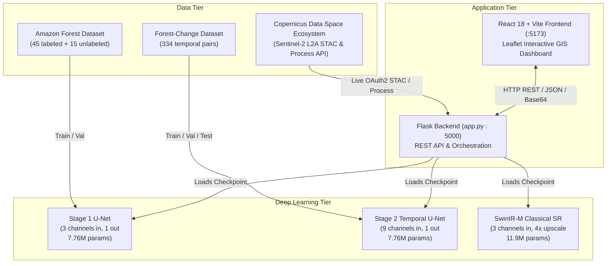
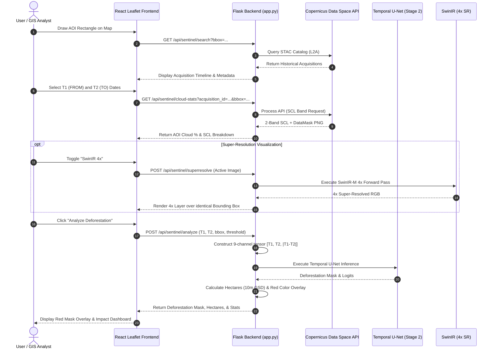

# Deforestation Detection from Satellite Imagery: Multi-Stage Forest Cover Segmentation, Bi-Temporal Change Detection, and Live Copernicus Sentinel-2 GIS Analysis with SwinIR Super-Resolution Visualization

**Technical Project Report**  
**Author / Engineering Team:** Project Development Team  
**Repository:** `vikaskmalipatil/Deforestation-Detection-from-Satellite-Images`  
**Date:** October 2026  
**Implementation State:** Verified Operational (Flask Backend + Vite/React Frontend + PyTorch 2.14)

---

## Table of Contents
1. [Title & Executive Summary](#1-title--executive-summary)
2. [Abstract](#2-abstract)
3. [Problem Statement](#3-problem-statement)
4. [Motivation](#4-motivation)
5. [Objectives](#5-objectives)
6. [Scope & Operational Boundaries](#6-scope--operational-boundaries)
7. [System Architecture](#7-system-architecture)
8. [Dataset Description & Class Distribution](#8-dataset-description--class-distribution)
9. [Data Preprocessing & Augmentation Pipeline](#9-data-preprocessing--augmentation-pipeline)
10. [Stage 1: Binary Forest Cover Segmentation (U-Net)](#10-stage-1-binary-forest-cover-segmentation-u-net)
11. [Stage 2: Bi-Temporal Deforestation Detection](#11-stage-2-bi-temporal-deforestation-detection)
12. [9-Channel Temporal Input Formulation](#12-9-channel-temporal-input-formulation)
13. [Deep Learning Model Architecture & Parameterization](#13-deep-learning-model-architecture--parameterization)
14. [Loss Functions & Class Imbalance Mitigation](#14-loss-functions--class-imbalance-mitigation)
15. [Evaluation Metrics & Mathematical Definitions](#15-evaluation-metrics--mathematical-definitions)
16. [Empirical Experimental Results](#16-empirical-experimental-results)
17. [Copernicus Sentinel-2 Live Earth Observation Pipeline](#17-copernicus-sentinel-2-live-earth-observation-pipeline)
18. [Geographic Information System (GIS) & AOI Processing](#18-geographic-information-system-gis--aoi-processing)
19. [Scene Classification Layer (SCL) Cloud Detection](#19-scene-classification-layer-scl-cloud-detection)
20. [SwinIR Classical Super-Resolution Visualization Module](#20-swinir-classical-super-resolution-visualization-module)
21. [Frontend Dashboard & Interactive User Interface](#21-frontend-dashboard--interactive-user-interface)
22. [Backend Architecture & RESTful API Specification](#22-backend-architecture--restful-api-specification)
23. [System Limitations & Scientific Domain Gaps](#23-system-limitations--scientific-domain-gaps)
24. [Security & Credential Management](#24-security--credential-management)
25. [Future Enhancements & Roadmap](#25-future-enhancements--roadmap)
26. [Conclusion](#26-conclusion)
27. [References & Technical Citations](#27-references--technical-citations)

---

## 1. Title & Executive Summary

### Title
**AI-Based Forest Cover Segmentation and Temporal Deforestation Detection Using Deep Convolutional Networks with Live Sentinel-2 Satellite Integration**

### Executive Summary
This report presents the complete engineering and scientific design, implementation, and empirical evaluation of an Earth Observation (EO) deep learning pipeline for forest monitoring. The system addresses two core remote sensing tasks:
1. **Static Canopy Segmentation (Stage 1):** Delineation of forest versus non-forest areas from single-date multispectral RGB imagery using a PyTorch U-Net architecture.
2. **Bi-Temporal Deforestation Detection (Stage 2):** Pixel-level detection of forest loss between two temporal acquisitions ($T_1$ and $T_2$) using a 9-channel Temporal U-Net that ingests pre-change imagery, post-change imagery, and an explicit radiometric absolute difference tensor ($|T_1 - T_2|$).

Beyond offline training, the system features a production-ready Web GIS platform. It integrates live Copernicus Data Space Ecosystem APIs to query, fetch, and analyze live Sentinel-2 Level-2A (L2A) satellite imagery over user-drawn Areas of Interest (AOIs). The platform includes AOI-specific cloud obscuration quantification derived from the Sentinel-2 Scene Classification Layer (SCL) and an isolated Swin Transformer Image Restoration (SwinIR) module that provides 4× super-resolution visualization for fine-grained canopy inspection.

---

## 2. Abstract
Monitoring planetary forest loss requires scalable automated analysis of satellite imagery. Traditional post-classification comparison (PCC) methods suffer from severe error multiplication when applied across multi-temporal datasets with domain shifts. In this work, we implement a two-stage deep learning architecture:
- **Stage 1** deploys a standard U-Net on the Amazon Forest Dataset, achieving a Mean Intersection-over-Union (IoU) of **0.8386** and a Mean Dice score of **0.9122** on the validation set.
- **Stage 2** implements an end-to-end 9-channel Temporal U-Net trained on the Forest-Change dataset under extreme class imbalance (4.77% positive deforestation pixels; negative-to-positive ratio of 19.94). Evaluated on an independent, held-out test split of 33 temporal image pairs (2,162,688 total pixels), the Stage 2 model achieves a Global IoU of **0.3828**, a Global Dice coefficient of **0.5536**, and an Overall Pixel Accuracy of **0.9632**.

To bridge model research and operational GIS monitoring, the system provides a Flask and React/Leaflet web platform connected to the European Space Agency (ESA) Copernicus Data Space Ecosystem. Users can define arbitrary AOIs, query historical Sentinel-2 L2A acquisitions via STAC, generate cloud-obscuration statistics from the 20-meter SCL layer, execute live bi-temporal inference with physical area calculation in hectares ($10\text{ m}$ GSD), and inspect 4× super-resolved imagery via SwinIR. We explicitly document model limitations, the domain gap between benchmark datasets and real-world Sentinel-2 imagery, and architectural boundaries.

---

## 3. Problem Statement
Remote sensing of deforestation presents several critical engineering and machine learning challenges:
1. **Severe Class Imbalance:** Deforestation events represent a tiny fraction of total land cover in satellite tiles (typically $< 5\%$ of pixels), causing standard cross-entropy loss functions to degenerate toward predicting the majority background class.
2. **Error Multiplication in Post-Classification Comparison:** Segmenting two separate images independently and calculating their set difference compounds false positives from both classifications, resulting in near-zero IoU when evaluating subtle forest loss.
3. **Atmospheric and Phenological Confounders:** Cloud cover, thin cirrus, cloud shadows, and seasonal vegetation changes (dry vs. wet season) frequently produce false spectral shifts that mimic canopy removal.
4. **Resolution Trade-offs:** Publicly available constellations like Sentinel-2 provide free 10-meter ground sample distance (GSD), which is sufficient for macro-monitoring but challenging for visual inspection of narrow logging roads or selective logging borders.
5. **Operational Integration:** Academic segmentation models typically exist as isolated scripts without interactive GIS capabilities, spatial coordinate reprojection, or live satellite API connectivity.

---

## 4. Motivation
Tropical forests, particularly the Amazon Basin and Southeast Asian rainforests, are critical carbon sinks and biodiversity reservoirs. Ground-based monitoring is physically impractical across vast, inaccessible terrains. Automated satellite monitoring enables rapid response by conservation agencies. By developing an accessible, open-source platform that pairs trained deep learning models with live Copernicus satellite access, this project lowers the barrier to deploying automated deforestation monitoring systems.

---

## 5. Objectives
1. **Develop Single-Temporal Forest Segmentation (Stage 1):** Train and validate a convolutional U-Net to segment static forest canopy with high precision and recall.
2. **Develop Bi-Temporal Change Detection (Stage 2):** Implement a direct temporal architecture ingesting paired acquisitions ($T_1$ and $T_2$) alongside explicit change priors to overcome PCC failure modes.
3. **Handle Severe Class Imbalance:** Implement and validate specialized loss functions (Positive-Weighted BCE and Focal Loss combined with Soft Dice) to ensure robust gradient backpropagation for rare change events.
4. **Connect Live Satellite APIs:** Establish a secure, authenticated integration with the Copernicus Data Space Ecosystem to query STAC catalogs and retrieve Level-2A surface reflectance imagery dynamically.
5. **Implement AOI-Specific Cloud Assessment:** Develop an algorithmic pipeline to calculate cloud and obscuration percentages inside arbitrary user-drawn bounding boxes using official Sentinel-2 SCL classifications.
6. **Integrate Visual Super-Resolution:** Integrate a pretrained SwinIR model to provide 4× spatial magnification for visual verification while strictly maintaining scientific isolation from the segmentation pipeline.
7. **Deliver an Interactive GIS Interface:** Construct an intuitive web interface with Leaflet mapping, before/after swipe comparisons, metric dashboards, and physical area reporting in hectares and square kilometers.

---

## 6. Scope & Operational Boundaries

### In Scope
- Single-image binary forest canopy segmentation on RGB satellite tiles.
- Bi-temporal change detection on paired $T_1$ and $T_2$ RGB images.
- 9-channel tensor concatenation $[T_1, T_2, |T_1 - T_2|]$.
- Live Copernicus STAC search and Process API true-color rendering over bounding boxes.
- Sentinel-2 SCL-based AOI cloud and shadow statistics.
- Pretrained SwinIR classical 4× super-resolution visualization.
- Interactive GIS map with Leaflet, Esri World Imagery, OpenStreetMap, opacity sliders, and swipe viewers.
- Area estimation based on Sentinel-2 10-meter pixel resolution ($1\text{ pixel} = 100\text{ m}^2 = 0.01\text{ ha}$).

### Out of Scope / Explicit Non-Claims
- **No Physical 2.5 m Satellite Imagery:** SwinIR output is generative spatial super-resolution for visual inspection. It does not synthesize genuine sub-pixel radiometric measurements.
- **No Cloud Inpainting / Removal:** The system computes cloud statistics and displays a cloud mask overlay, but does not reconstruct ground pixels obscured by clouds.
- **Cloud Pixels Are Not Excluded From Inference:** In the current implementation, cloudy pixels in live Sentinel-2 images are passed directly to the Temporal U-Net without being masked out. Users must inspect cloud statistics prior to analysis.
- **No Disturbance Driver Classification:** The model predicts binary forest loss; it does not classify proximate drivers (e.g., wildfire, logging roads, cattle ranching, agriculture).
- **No Temporal Sequences > 2:** The model operates strictly on bi-temporal pairs ($T_1 \to T_2$). It does not incorporate Recurrent Neural Networks (RNNs) or temporal transformers for arbitrary length time series.
- **No Ground-Truth Validation on Live Sentinel-2:** Live Sentinel-2 inference produces predicted change percentages and estimated hectares, but lacks ground-truth masks for arbitrary live queries. Formal IoU/Dice metrics apply strictly to benchmark datasets.

---

## 7. System Architecture

The project employs a three-tier decoupled client-server architecture:



### End-to-End Workflow Pipeline



---

## 8. Dataset Description & Class Distribution

The repository utilizes two primary local datasets and one live satellite provider:

### 8.1 Amazon Forest Dataset (Stage 1)
- **Source:** High-resolution satellite tiles of Amazon forest canopy.
- **Format:** Uncompressed TIFF images with paired PNG binary ground-truth masks.
- **Splits:**
  - `Training`: 30 images + 30 masks
  - `Validation`: 15 images + 15 masks
  - `Test`: 15 unlabeled images (0.tiff through 14.tiff)
  - Total: 60 images (45 labeled, 15 unlabeled)
- **Mask Encoding:**
  - Raw Pixel Value `2` $\to$ **Forest Cover** (Class 1)
  - Raw Pixel Value `1` $\to$ **Non-Forest / Background** (Class 0)

### 8.2 Forest-Change Dataset (Stage 2)
- **Source:** Bi-temporal satellite change detection benchmark dataset.
- **Structure:** Subdirectories `A/` (pre-change image $T_1$), `B/` (post-change image $T_2$), and `label/` (binary ground-truth change mask).
- **Native Resolution:** $480 \times 480$ pixels, 3-channel RGB PNGs.
- **Ground-Truth Encoding:** Multi-value grayscale intensity ($[0, 32, 64, \dots, 255]$). The pipeline applies binary thresholding: any pixel $> 0$ represents confirmed deforestation.
- **Splits:**
  - `train`: 270 matched pairs
  - `val`: 31 matched pairs
  - `test`: 33 matched pairs
  - Total: 334 temporal pairs (668 satellite images, 334 masks)

#### Empirical Class Imbalance Audit
An exhaustive pixel-level audit across all 334 dataset pairs reveals severe class imbalance:

| Split | Number of Pairs | Positive Pixels (Deforestation) | Negative Pixels (Background) | Positive Class Ratio | Imbalance Ratio ($\text{Neg}/\text{Pos}$) |
|---|---|---|---|---|---|
| **Train** | 270 | 844,851 | 16,849,869 | **4.77%** | **19.94 : 1** |
| **Validation** | 31 | 106,999 | 1,924,617 | **5.27%** | **17.99 : 1** |
| **Test** | 33 | 101,274 | 2,061,414 | **4.68%** | **20.35 : 1** |
| **Combined** | 334 | 1,053,124 | 20,835,900 | **4.81%** | **19.78 : 1** |

Deforestation accounts for under 5% of total surface area. Without class weighting, a trivial model predicting all zeros achieves $> 95\%$ accuracy while providing zero utility.

### 8.3 Copernicus Sentinel-2 L2A (Live Operational Data)
- **Provider:** European Space Agency (ESA) via Copernicus Data Space Ecosystem.
- **Product:** Level-2A Bottom-Of-Atmosphere (BOA) surface reflectance.
- **Bands Ingested:** B04 (Red, 665 nm), B03 (Green, 560 nm), B02 (Blue, 490 nm) at 10-meter spatial resolution.
- **Ancillary Bands:** SCL (Scene Classification Layer) at 20-meter spatial resolution.

---

## 9. Data Preprocessing & Augmentation Pipeline

### 9.1 Preprocessing Pipeline
1. **Geometric Standardization:** All input images are resized to a fixed training dimension of $256 \times 256$ pixels using bilinear interpolation (`Image.Resampling.BILINEAR`).
2. **Mask Nearest-Neighbor Resampling:** Ground-truth masks are resized using nearest-neighbor interpolation (`Image.Resampling.NEAREST`) to preserve sharp class boundaries without creating interpolated intermediate values.
3. **Radiometric Normalization:** Raw uint8 pixel values $[0, 255]$ are converted to float32 and normalized into the range $[0.0, 1.0]$ via division by $255.0$.
4. **Channel Reordering:** NumPy arrays $(H, W, C)$ are transposed into standard PyTorch tensor layout $(C, H, W)$.

### 9.2 Data Augmentation Pipeline
To prevent overfitting on the limited training splits, the training dataset loaders apply synchronized spatial augmentations across paired images and masks:
- **Random Horizontal Flip:** Applied with probability $p = 0.5$ (`np.fliplr`).
- **Random Vertical Flip:** Applied with probability $p = 0.5$ (`np.flipud`).
- **Random Orthogonal Rotations:** Discrete 90-degree rotations $k \in \{0, 1, 2, 3\}$ applied with uniform probability (`np.rot90`).
- *Synchronization Guarantee:* For Stage 2, transformations are computed using identical random seeds across $T_1$, $T_2$, and the change label to guarantee geometric consistency.

---

## 10. Stage 1: Binary Forest Cover Segmentation (U-Net)

### 10.1 Task Formulation
Stage 1 addresses single-acquisition forest canopy mapping. Given a multispectral RGB satellite image $\mathbf{X} \in \mathbb{R}^{3 \times H \times W}$, the model predicts a binary probability map $\hat{\mathbf{Y}} \in [0, 1]^{1 \times H \times W}$ where $\hat{y}_{ij} \ge \tau$ indicates the presence of forest canopy.

### 10.2 Architectural Implementation
The network follows the canonical U-Net architecture (`src/model.py`):
- **Base Feature Channels:** 32
- **Encoder:** 4 downsampling stages utilizing DoubleConv blocks followed by $2 \times 2$ MaxPool layers ($3 \to 32 \to 64 \to 128 \to 256 \to 512$).
- **Bottleneck:** Feature depth of 512 channels.
- **Decoder:** 4 upsampling stages using $2 \times 2$ transposed convolutions (`ConvTranspose2d`) concatenated with corresponding encoder skip connections, processed through DoubleConv blocks ($512 \to 256 \to 128 \to 64 \to 32$).
- **Final Projection:** $1 \times 1$ convolution mapping 32 channels to 1 logit output.
- **Trainable Parameters:** **7,763,041** parameters.

---

## 11. Stage 2: Bi-Temporal Deforestation Detection

### 11.1 The Failure of Post-Classification Comparison (PCC)
The initial hypothesis investigated whether two independent Stage 1 segmentations could detect deforestation via post-classification subtraction:
$$\Delta \mathbf{Y}_{\text{PCC}} = (\hat{\mathbf{Y}}_{T_1} == 1) \land (\hat{\mathbf{Y}}_{T_2} == 0)$$

When evaluated on the Forest-Change dataset (`outputs/temporal/temporal_results.json`, pair `test_000001`), this approach failed catastrophically:
- **PCC Intersection over Union (IoU):** **0.0026** (0.26%)
- **PCC Dice Score:** **0.0051** (0.51%)
- **PCC Precision:** **0.0096** (0.96%)
- **PCC Recall:** **0.0035** (0.35%)
- **False Positives:** 1,865 pixels
- **False Negatives:** 5,127 pixels

**Root Cause Analysis:** PCC compounds errors multiplicatively. Minor radiometric differences, shadow variations, phenological shifts, and domain discrepancies between the Amazon training set and Forest-Change test set caused slight mask boundary variations. Because true deforestation is rare, these boundary variations completely overwhelmed the actual change signal.

### 11.2 The Direct Temporal U-Net Solution
To resolve this, Stage 2 was re-architected as an end-to-end bi-temporal change detection model. The network ingests both temporal acquisitions simultaneously and is trained to predict the change mask directly, allowing internal convolutional layers to learn joint temporal representations.

---

## 12. 9-Channel Temporal Input Formulation

### 12.1 Mathematical Formulation
Let $\mathbf{I}_{T_1} \in \mathbb{R}^{3 \times H \times W}$ represent the pre-change RGB image and $\mathbf{I}_{T_2} \in \mathbb{R}^{3 \times H \times W}$ represent the post-change RGB image.

We construct the 9-channel input tensor $\mathbf{X}_{\text{temp}}$ by concatenating pre-change, post-change, and the absolute difference along the channel dimension:
$$\mathbf{D} = |\mathbf{I}_{T_1} - \mathbf{I}_{T_2}| \in \mathbb{R}^{3 \times H \times W}$$
$$\mathbf{X}_{\text{temp}} = \left[ \mathbf{I}_{T_1} \parallel \mathbf{I}_{T_2} \parallel \mathbf{D} \right] \in \mathbb{R}^{9 \times H \times W}$$

Where:
- Channels $0, 1, 2$: Pre-change Red, Green, Blue ($T_1$)
- Channels $3, 4, 5$: Post-change Red, Green, Blue ($T_2$)
- Channels $6, 7, 8$: Absolute Spectral Difference $|\Delta \text{Red}|, |\Delta \text{Green}|, |\Delta \text{Blue}|$

### 12.2 Architectural Rationale
While a deep network can theoretically learn subtraction from a 6-channel stack $[\mathbf{I}_{T_1} \parallel \mathbf{I}_{T_2}]$, explicitly providing the absolute difference tensor acts as an inductive bias. It directly surfaces spectral magnitude variations in the first convolutional layer, allowing intermediate feature maps to focus on distinguishing vegetation clearance from seasonal luminance fluctuations.

### 12.3 Parameter Impact
The transition from 6-channel to 9-channel input increases the total model parameters by only 864 weights (from 7,763,905 to 7,764,769 parameters, a **0.011%** increase), localized entirely to the first convolutional filter bank:
$$\Delta \text{weights} = (9 - 6) \times 32 \times (3 \times 3) = 864\text{ parameters}$$

---

## 13. Deep Learning Model Architecture & Parameterization

### 13.1 Layer-by-Layer Architectural Specification
The `TemporalUNet` (`src/temporal_model.py`) is structured as follows:

```
[Input Tensor: 9 x 256 x 256]
       │
       ▼
[inc: DoubleConv] ───────────────────────────┐ (Skip 1: 32 x 256 x 256)
 (9 -> 32 -> 32)                             │
       │                                     │
       ▼ MaxPool (2x2)                       │
[down1: DoubleConv] ───────────────────────┐ │ (Skip 2: 64 x 128 x 128)
 (32 -> 64 -> 64)                          │ │
       │                                   │ │
       ▼ MaxPool (2x2)                     │ │
[down2: DoubleConv] ─────────────────────┐ │ │ (Skip 3: 128 x 64 x 64)
 (64 -> 128 -> 128)                      │ │ │
       │                                 │ │ │
       ▼ MaxPool (2x2)                   │ │ │
[down3: DoubleConv] ───────────────────┐ │ │ │ (Skip 4: 256 x 32 x 32)
 (128 -> 256 -> 256)                   │ │ │ │
       │                               │ │ │ │
       ▼ MaxPool (2x2)                 │ │ │ │
[down4: Bottleneck DoubleConv]         │ │ │ │
 (256 -> 512 -> 512)                   │ │ │ │
       │                               │ │ │ │
       ▼ ConvTranspose2d (512 -> 256)  │ │ │ │
[conv_up1: Cat(Skip 4) + DoubleConv] ◄─┘ │ │ │
 (512 -> 256 -> 256)                     │ │ │
       │                                 │ │ │
       ▼ ConvTranspose2d (256 -> 128)    │ │ │
[conv_up2: Cat(Skip 3) + DoubleConv] ◄───┘ │ │
 (256 -> 128 -> 128)                       │ │
       │                                   │ │
       ▼ ConvTranspose2d (128 -> 64)       │ │
[conv_up3: Cat(Skip 2) + DoubleConv] ◄─────┘ │
 (128 -> 64 -> 64)                           │
       │                                     │
       ▼ ConvTranspose2d (64 -> 32)          │
[conv_up4: Cat(Skip 1) + DoubleConv] ◄───────┘
 (64 -> 32 -> 32)
       │
       ▼ Conv2d (1x1, 32 -> 1)
[Output Logits: 1 x 256 x 256]
```

### 13.2 Checkpoint Compatibility Layer
In earlier experimental iterations, the upsampling blocks were named `cu1`, `cu2`, `cu3`, `cu4`. The current production codebase standardized these to `conv_up1`, `conv_up2`, `conv_up3`, `conv_up4`. Both `app.py` and `evaluate_temporal.py` implement an automated key-remapping loader:

```python
new_state_dict = {}
for k, v in state_dict.items():
    nk = k.replace("cu1.", "conv_up1.").replace("cu2.", "conv_up2.") \
          .replace("cu3.", "conv_up3.").replace("cu4.", "conv_up4.")
    new_state_dict[nk] = v
```
This ensures backwards compatibility with saved weights without requiring checkpoint re-serialization.

---

## 14. Loss Functions & Class Imbalance Mitigation

Due to the 19.94:1 negative-to-positive class imbalance, models trained with unweighted binary cross-entropy fail to detect change boundaries. Two specialized composite loss functions were developed:

### 14.1 Weighted BCE + Soft Dice Loss (`WeightedBCEDiceLoss`)
$$\mathcal{L}_{\text{WBCE+Dice}} = w_{\text{bce}} \cdot \mathcal{L}_{\text{WBCE}}(z, y) + w_{\text{dice}} \cdot \mathcal{L}_{\text{Dice}}(\sigma(z), y)$$

Where:
$$\mathcal{L}_{\text{WBCE}}(z, y) = - \left[ w_{\text{pos}} \cdot y \log(\sigma(z)) + (1 - y) \log(1 - \sigma(z)) \right]$$
$$\mathcal{L}_{\text{Dice}}(\hat{p}, y) = 1 - \frac{2 \sum \hat{p} y + \epsilon}{\sum \hat{p} + \sum y + \epsilon}$$
With $w_{\text{pos}} = 19.94$, $w_{\text{bce}} = 0.5$, $w_{\text{dice}} = 0.5$, and smoothing factor $\epsilon = 10^{-6}$.

### 14.2 Focal Loss + Soft Dice Loss (`FocalDiceLoss`)
For hard mining of subtle deforestation boundaries, Focal Loss dynamically scales the cross-entropy loss based on model confidence:
$$\mathcal{L}_{\text{Focal}}(z, y) = - \alpha_t (1 - p_t)^\gamma \log(p_t)$$
Where:
$$p_t = \begin{cases} \sigma(z) & \text{if } y = 1 \\ 1 - \sigma(z) & \text{if } y = 0 \end{cases}$$
$$\alpha_t = \begin{cases} \alpha & \text{if } y = 1 \\ 1 - \alpha & \text{if } y = 0 \end{cases}$$
With focusing parameter $\gamma = 2.0$, alpha balance $\alpha = 0.75$, and composite combination:
$$\mathcal{L}_{\text{Stage2}} = 0.5 \cdot \mathcal{L}_{\text{Focal}} + 0.5 \cdot \mathcal{L}_{\text{Dice}}$$

### 14.3 Training Optimization Hyperparameters
- **Optimizer:** Adam ($\beta_1 = 0.9, \beta_2 = 0.999, \epsilon = 10^{-8}$)
- **Initial Learning Rate:** $1 \times 10^{-3}$
- **Learning Rate Scheduler:** ReduceLROnPlateau (factor 0.5, patience 3 epochs)
- **Batch Size:** 4
- **Maximum Epochs:** 30 with Early Stopping (patience = 8 epochs)
- **Best Validation Checkpoint:** Saved at **Epoch 21** with $\text{Val IoU} = 0.504266$.

---

## 15. Evaluation Metrics & Mathematical Definitions

All quantitative evaluations are computed using standardized pixel-level confusion matrix formulations:
- **True Positives (TP):** Pixels correctly predicted as positive (deforestation / forest canopy).
- **False Positives (FP):** Background pixels incorrectly predicted as positive.
- **False Negatives (FN):** Positive pixels incorrectly predicted as background.
- **True Negatives (TN):** Background pixels correctly predicted as background.

### Mathematical Formulations

1. **Intersection over Union (IoU / Jaccard Index):**
   $$\text{IoU} = \frac{\text{TP}}{\text{TP} + \text{FP} + \text{FN}}$$

2. **Dice Coefficient (F1 Score):**
   $$\text{Dice} = \frac{2 \cdot \text{TP}}{2 \cdot \text{TP} + \text{FP} + \text{FN}}$$

3. **Precision:**
   $$\text{Precision} = \frac{\text{TP}}{\text{TP} + \text{FP}}$$

4. **Recall (Sensitivity):**
   $$\text{Recall} = \frac{\text{TP}}{\text{TP} + \text{FN}}$$

5. **Pixel Accuracy:**
   $$\text{Accuracy} = \frac{\text{TP} + \text{TN}}{\text{TP} + \text{TN} + \text{FP} + \text{FN}}$$

---

## 16. Empirical Experimental Results

All reported values are verified against raw evaluation outputs in `outputs/`.

### 16.1 Stage 1: Forest Cover Segmentation (Amazon Forest Dataset)
Evaluated on the held-out validation set of 15 samples (`outputs/evaluation_metrics.json` and `outputs/evaluation_report.txt`):

- **Model Checkpoint:** `models/best_unet_model.pth`
- **Best Training Epoch:** Epoch 5
- **Prediction Threshold:** $\tau = 0.5$
- **Total Validation Samples:** 15

| Metric | Measured Value | Percentage Representation |
|---|---|---|
| **Mean IoU (Jaccard Index)** | `0.8385551377629015` | **83.86%** |
| **Mean Dice (F1 Score)** | `0.9121892735653608` | **91.22%** |
| **Mean Precision** | `0.9220567645670562` | **92.21%** |
| **Mean Recall** | `0.9025307424186895` | **90.25%** |
| **Mean Pixel Accuracy** | `0.9093271891276041` | **90.93%** |

### 16.2 Stage 2: Temporal Deforestation Detection (Forest-Change Dataset)
Evaluated on the held-out, unseen test split of 33 image pairs comprising **2,162,688 total pixels** (`outputs/temporal/temporal_test_results.json` and `outputs/temporal/temporal_test_report.txt`):

- **Model Checkpoint:** `models/best_temporal_model.pth`
- **Training Checkpoint Epoch:** Epoch 21
- **Best Validation IoU (during training):** `0.5042657685060166` (50.43%)
- **Architecture:** 9-Channel Temporal U-Net with $|T_1 - T_2|$ difference tensor
- **Loss Configuration:** Focal Loss + Soft Dice (`focal_dice`)
- **Evaluation Split:** Test split (33 pairs)
- **Decision Threshold:** $\tau = 0.5$

#### Global Test Set Quantitative Metrics

| Metric | Measured Value | Percentage Representation |
|---|---|---|
| **Global IoU** | `0.3827710357242621` | **38.28%** |
| **Global Dice (F1 Score)** | `0.5536289462756585` | **55.36%** |
| **Global Precision** | `0.6412156189881973` | **64.12%** |
| **Global Recall** | `0.4870944171258171` | **48.71%** |
| **Global Pixel Accuracy** | `0.9632189201586174` | **96.32%** |

#### Pixel-Level Confusion Counts

| Confusion Matrix Element | Pixel Count | Description |
|---|---|---|
| **True Positives (TP)** | `49,330` | Deforestation pixels correctly detected |
| **False Positives (FP)** | `27,602` | Stable pixels incorrectly predicted as change |
| **False Negatives (FN)** | `51,944` | True deforestation pixels missed by the model |
| **True Negatives (TN)** | `2,033,812` | Stable forest/background correctly identified |
| **Total Test Pixels** | `2,162,688` | Evaluated across all 33 test pairs |

#### Aggregate Deforestation Coverage Comparison
- **Total Ground-Truth Deforestation:** `101,274` pixels (**4.6828%** of total area)
- **Total Predicted Deforestation:** `76,932` pixels (**3.5572%** of total area)
- **Change Ratio Captured:** The model detects approximately 76% of the true change footprint while maintaining a high precision of 64.12% and an overall accuracy of 96.32%.

---

## 17. Copernicus Sentinel-2 Live Earth Observation Pipeline

To operationalize deforestation detection beyond offline datasets, the backend integrates directly with the European Copernicus Data Space Ecosystem.

### 17.1 Authentication & Token Lifecycle
Authentication uses OAuth2 Client Credentials (`app.py`):
- **Token Endpoint:** `https://identity.dataspace.copernicus.eu/auth/realms/CDSE/protocol/openid-connect/token`
- **Client Credentials:** `SENTINEL_CLIENT_ID` and `SENTINEL_CLIENT_SECRET` loaded from environment variables.
- **Token Caching:** Access tokens are cached in-memory with a 60-second safety margin before expiry.
- **Endpoint Status:** `GET /api/sentinel/status` allows the frontend to verify API availability without exposing raw secrets.

### 17.2 Spatio-Temporal Search (STAC API)
Acquisitions are discovered via the SpatioTemporal Asset Catalog (STAC) endpoint:
- **STAC Endpoint:** `https://sh.dataspace.copernicus.eu/api/v1/catalog/1.0.0/search`
- **Collection:** `sentinel-2-l2a`
- **Query Filter:** Bounding box `[west, south, east, north]`, datetime interval, and optional maximum scene cloud cover filter (`eo:cloud_cover <= max_cloud`).
- **Response Normalization:** Results are formatted into a sorted chronological list containing acquisition IDs, timestamps, tile identifiers, and scene cloud percentages.

### 17.3 On-The-Fly Rendering (Process API)
Satellite imagery is dynamically rendered via the Sentinel Hub Process API:
- **Process Endpoint:** `https://sh.dataspace.copernicus.eu/api/v1/process`
- **Evalscript Specification:** A custom JavaScript evalscript converts raw BOA reflectance integers into calibrated uint8 RGB:
```javascript
//VERSION=3
function setup() {
  return {
    input: ["B04", "B03", "B02"],
    output: { bands: 3, sampleType: "AUTO" }
  };
}
function evaluatePixel(sample) {
  return [2.5 * sample.B04, 2.5 * sample.B03, 2.5 * sample.B02];
}
```
- **Dynamic Resampling:** The Process API dynamically clips, reprojects, and resamples the requested geographic bounding box into standard $512 \times 512$ or $256 \times 256$ PNG tiles.

### 17.4 Physical Area Estimation
Because Sentinel-2 Level-2A RGB bands possess a native Ground Sample Distance (GSD) of $10\text{ meters} \times 10\text{ meters}$, physical area metrics are calculated directly:
$$\text{Area per Pixel} = 10\text{ m} \times 10\text{ m} = 100\text{ m}^2$$
$$\text{Deforested Hectares} = \frac{\text{Deforested Pixels} \times 100\text{ m}^2}{10,000\text{ m}^2/\text{ha}} = \text{Deforested Pixels} \times 0.01\text{ ha}$$
$$\text{Deforested Square Kilometers} = \frac{\text{Deforested Hectares}}{100}$$

---

## 18. Geographic Information System (GIS) & AOI Processing

### 18.1 Coordinate Normalization & Antimeridian Wrapping
Leaflet uses an unbounded continuous-world coordinate system where panning across the antimeridian can produce longitude values outside $[-180, 180]$. The frontend implements modular longitude wrapping:

```javascript
function wrapLng(lng) {
  if (lng >= -180 && lng <= 180) return lng;
  return ((((lng + 180) % 360) + 360) % 360) - 180;
}
```
Leaflet is initialized with `worldCopyJump: true`, and the map starts at a neutral global overview:
- **Initial Center:** `[20.0, 0.0]` (Neutral global latitude/longitude)
- **Initial Zoom:** Level `2`

### 18.2 Layer Management & Overlays
The GIS viewer manages several concurrent layer types:
1. **Base Cartography:** Esri World Imagery (Satellite) and OpenStreetMap (Standard), switchable via UI toggle.
2. **Sentinel-2 Acquisition Overlays:** Dynamic `L.imageOverlay` projected over the exact bounding box $[ [ \text{south}, \text{west} ], [ \text{north}, \text{east} ] ]$.
3. **SwinIR 4× Super-Resolution Overlay:** SwinIR-rendered high-density imagery projected over the identical geographic bounds.
4. **Cloud Mask Overlay:** Cyan-tinted obstruction mask projected over obscured pixels.
5. **Deforestation Detection Mask:** Semi-transparent red overlay (`#dc2626`, 65% opacity) indicating detected forest loss.

---

## 19. Scene Classification Layer (SCL) Cloud Detection

### 19.1 Scene-Level vs. AOI-Specific Cloud Cover
Standard satellite catalogs report scene-level cloud coverage (`eo:cloud_cover`), which measures cloud percentage across the entire $100\text{ km} \times 100\text{ km}$ Sentinel-2 tile. This is often misleading for localized monitoring: a tile with 40% cloud cover may be completely clear over a specific $5\text{ km} \times 5\text{ km}$ AOI, or vice versa.

The `/api/sentinel/cloud-stats` endpoint computes **AOI-specific cloud cover** directly from the Sentinel-2 L2A Scene Classification Layer (SCL).

### 19.2 SCL Class Taxonomy
The ESA SCL classifies pixels into 12 distinct categories:

| SCL Value | Class Name | Category in System | Included in Cloud Mask |
|---|---|---|:---:|
| `0` | `no_data` | Invalid / Border | Excluded |
| `1` | `saturated_or_defective` | Defective Sensor | Excluded |
| `2` | `dark_area_pixels` | Ground / Topographic Shadow | Clear |
| `3` | `cloud_shadows` | Atmospheric Obstruction | **Yes** |
| `4` | `vegetation` | Ground Canopy | Clear |
| `5` | `bare_soils` | Ground Soil | Clear |
| `6` | `water` | Water Body | Clear |
| `7` | `unclassified` | Ambiguous / Low-Probability Cloud | **Yes** |
| `8` | `cloud_medium_probability` | Cloud | **Yes** |
| `9` | `cloud_high_probability` | Dense Cloud | **Yes** |
| `10` | `thin_cirrus` | Semi-Transparent Cloud | **Yes** |
| `11` | `snow_or_ice` | Cryosphere | Clear |

### 19.3 SCL Evalscript & Processing Pipeline
To calculate cloud coverage, the backend requests the SCL and `dataMask` bands from the Process API:

```javascript
//VERSION=3
function setup() {
  return {
    input: [{ bands: ["SCL", "dataMask"] }],
    output: { bands: 2, sampleType: "UINT8" }
  };
}
function evaluatePixel(sample) {
  return [sample.SCL, sample.dataMask * 255];
}
```

The cloud percentage is computed over valid pixels (`dataMask == 1`):
$$\text{Valid Pixels} = \sum (\text{dataMask} > 0)$$
$$\text{Cloud Pixels} = \sum (\text{valid} \land \text{SCL} \in \{3, 7, 8, 9, 10\})$$
$$\text{Cloud Percentage} = \frac{\text{Cloud Pixels}}{\text{Valid Pixels}} \times 100\%$$
$$\text{Clear Percentage} = \frac{\text{Clear Pixels}}{\text{Valid Pixels}} \times 100\%$$

If AOI cloud obscuration exceeds 20%, the frontend displays an `AlertTriangle` warning advising the analyst that inference reliability may be degraded.

---

## 20. SwinIR Classical Super-Resolution Visualization Module

### 20.1 Purpose & Architectural Isolation
To assist visual verification of forest boundaries and logging tracks, the system integrates a Swin Transformer Image Restoration (SwinIR) module (`src/swinir/`).

**Architectural Boundary:** SwinIR is strictly isolated from the segmentation pipeline. It operates solely as a client-side visualization enhancement. The original 10-meter Sentinel-2 RGB image is always passed to the Stage 2 Temporal U-Net for deforestation inference.

### 20.2 Model Architecture & Pretrained Checkpoint
- **Architecture:** SwinIR-M Classical Super-Resolution ($\times 4$ upscale)
- **Pretrained Weights:** `001_classicalSR_DF2K_s64w8_SwinIR-M_x4.pth` (trained on DF2K, stored locally at `models/swinir_x4.pth`, 67.8 MB)
- **Trainable Parameters:** **11,900,199** parameters
- **Configuration:**
  - `patch_size` = 1, `in_chans` = 3, `embed_dim` = 180
  - Residual Swin Transformer Blocks (RSTB): 6 blocks
  - Swin Transformer Layers (STL) per block: 6 layers (depths = `[6, 6, 6, 6, 6, 6]`)
  - Attention Heads: `[6, 6, 6, 6, 6, 6]`
  - Window Size: $8 \times 8$
  - Upsampler: PixelShuffle ($\times 4$)

### 20.3 Padding & Inference Execution
To satisfy SwinIR's window-based attention constraints, images whose spatial dimensions are not multiples of the window size ($w = 8$) are reflect-padded prior to inference and cropped back to exact $4H \times 4W$ dimensions after the forward pass:

```python
pad_h = (8 - h % 8) % 8
pad_w = (8 - w % 8) % 8
padded = np.pad(img, ((0, pad_h), (0, pad_w), (0, 0)), mode='reflect')
```
Each RGB color channel is processed independently as float32 in $[0.0, 1.0]$. The output is clipped to $[0.0, 1.0]$, converted to uint8, and returned as a base64-encoded PNG.

### 20.4 Scientific Clarification: Visualization vs. Sensor Resolution
The SwinIR module increases display pixel density by $4\times$ (e.g., transforming a $512 \times 512$ tile representing 10m pixels into a $2048 \times 2048$ grid representing 2.5m-scale pixels). **This is spatial interpolation via learned generative priors; it does not produce genuine sub-pixel radiometric measurements.** The UI explicitly labels this output:
> *"SwinIR 4× Super-Resolved Visualization: Increases image pixel density for visualization; does not create true 2.5 m satellite measurements."*

---

## 21. Frontend Dashboard & Interactive User Interface

The web interface is built with React 18, Vite, and Leaflet (`frontend/src/`):

### 21.1 Five Functional Application Views
1. **Historical Satellite & Forest Change GIS Map (`gis-map`):**
   - Leaflet interactive map with custom rectangle AOI drawing tools.
   - Live Sentinel-2 acquisition search timeline with calendar controls.
   - SCL cloud statistics panel showing Cloud % and Clear % for FROM and TO dates.
   - SwinIR 4× super-resolution toggle for visual inspection.
   - Live Temporal U-Net inference execution with red deforestation overlay and physical area reporting in hectares and square kilometers.
2. **Stage 1: Binary Forest Cover Segmentation (`stage1`):**
   - Single-image segmentation workbench using `best_unet_model.pth`.
   - Sample selector from Amazon Forest Dataset validation and test splits, plus custom image file upload.
   - Adjustable decision threshold slider ($\tau \in [0.1, 0.9]$).
   - Canopy mask rendering and forest area reporting.
3. **Stage 2: Temporal Deforestation Change Detection (`stage2`):**
   - Bi-temporal change detection workbench using `best_temporal_model.pth`.
   - Sample selector from Forest-Change test split, plus independent $T_1$ and $T_2$ image uploads.
   - Threshold slider, raw difference visualization, and change mask display.
4. **Temporal Swipe Comparison Viewer (`swipe`):**
   - Interactive split-screen comparison slider.
   - Compares Pre-change ($T_1$) on the left with Post-change ($T_2$ + Deforestation Overlay) on the right.
5. **Model Performance Analytics (`metrics`):**
   - Live dashboard dynamically populated via `GET /api/metrics`.
   - Displays unrounded validation metrics for Stage 1 and held-out test metrics for Stage 2.

---

## 22. Backend Architecture & RESTful API Specification

The backend service is implemented in Flask 3.1 with CORS support (`app.py`). It runs on `127.0.0.1:5000` and serves 13 REST API endpoints:

| Method | Endpoint Route | Parameters / Payload | Description & Response Summary |
|---|---|---|---|
| `GET` | `/` | None | Serves compiled React production bundle `templates/index.html`. |
| `GET` | `/api/sentinel/status` | None | Returns Copernicus API configuration status and masked Client ID. |
| `GET` | `/api/sentinel/info` | None | Returns Sentinel-2 integration metadata (10m GSD, bands B04/B03/B02). |
| `GET` | `/api/sentinel/search` | `bbox`, `lat`, `lon`, `from`, `to`, `max_cloud` | Queries CDSE STAC catalog; returns sorted list of acquisitions. |
| `GET` | `/api/sentinel/preview` | `acquisition_id`, `bbox`, `width`, `height` | Queries CDSE Process API; returns base64 true-color RGB PNG. |
| `GET` | `/api/sentinel/cloud-stats` | `acquisition_id`, `bbox`, `resolution` | Queries SCL band; returns AOI cloud %, clear %, and SCL class histogram. |
| `POST` | `/api/sentinel/analyze` | JSON: `image_before`, `image_after`, `bbox`, `threshold` | Executes Stage 2 Temporal U-Net on Sentinel pair; returns mask and hectares. |
| `POST` | `/api/sentinel/superresolve` | JSON: `image` (base64) | Runs SwinIR 4× super-resolution; returns 4× enlarged base64 PNG. |
| `GET` | `/api/sentinel/superresolve/status` | None | Checks whether `models/swinir_x4.pth` is available on disk. |
| `GET` | `/api/gis/regions` | None | Returns predefined global forest monitoring regions with coordinates. |
| `GET` | `/api/samples` | None | Returns local dataset sample catalogs for Stage 1 and Stage 2 test splits. |
| `POST` | `/api/predict/stage1` | Form: `sample_path` or `file`, `threshold` | Executes Stage 1 U-Net; returns binary forest mask and canopy metrics. |
| `POST` | `/api/predict/stage2` | Form: `sample_id` or `files`, `threshold` | Executes Stage 2 U-Net; returns deforestation mask and pixel metrics. |
| `GET` | `/api/metrics` | None | Returns recorded benchmark JSON metrics (`evaluation_metrics.json`). |

---

## 23. System Limitations & Scientific Domain Gaps

### 23.1 Benchmark vs. Operational Domain Gap
The Stage 2 Temporal U-Net was trained on the Forest-Change dataset, which consists of normalized aerial/satellite crops with specific sensor characteristics. When applied to live Copernicus Sentinel-2 Level-2A surface reflectance tiles, the model encounters a noticeable domain shift:
- Differences in atmospheric scattering correction.
- Discrepancies in spatial resolution and point spread functions.
- Seasonal phenological variations (sun zenith angle, wet vs. dry season greenness).
- Consequently, live Sentinel-2 inferences may exhibit false positives along water bodies or seasonal pasture transitions. **The test metrics measured on Forest-Change (38.28% IoU) cannot be assumed to translate directly to live Sentinel-2 scenes without domain adaptation.**

### 23.2 Cloud Contamination During Inference
While the system provides SCL-based cloud statistics and a visual cloud mask overlay, **cloudy pixels are not masked out during Temporal U-Net inference**. Passing images with cloud cover or cloud shadows through the change detection model will produce false positive detections. Analysts must verify that AOI cloud cover is $< 10\%$ before running deforestation analysis.

### 23.3 Absence of Ground Truth in Live Operations
In live Sentinel-2 monitoring, the system reports detected change pixels, deforestation percentage, and estimated hectares. **It does not report IoU, Dice, Precision, or Recall for live queries**, as ground-truth masks do not exist for arbitrary real-time satellite queries.

### 23.4 CPU Inference Latency
On CPU environments, running SwinIR 4× super-resolution over a $512 \times 512$ tile requires processing a $2048 \times 2048$ feature space across 6 Swin transformer blocks, taking 1 to 2 minutes. GPU acceleration is strongly recommended for operational use.

---

## 24. Security & Credential Management

- **Zero Secret Exposure:** Copernicus OAuth2 credentials (`SENTINEL_CLIENT_ID` and `SENTINEL_CLIENT_SECRET`) are managed strictly via local environment variables. They are excluded from version control via `.gitignore`.
- **Masked Status Inspection:** The `/api/sentinel/status` endpoint displays only a masked preview (e.g., `3732...370a`), preventing credential leakage through browser inspection tools.
- **Client Separation:** All external API requests to Copernicus are mediated by the Flask backend; the frontend never interacts directly with CDSE authentication services.

---

## 25. Future Enhancements & Roadmap

1. **Integrated Cloud Masking in Inference:** Update the Temporal U-Net input pipeline to ingest the SCL band as a 10th channel or automatically mask cloudy pixels with a neutral value prior to inference.
2. **Domain Adaptation & Fine-Tuning:** Fine-tune the Temporal U-Net directly on paired Sentinel-2 L2A tiles annotated with official PRODES/DETER deforestation ground truth.
3. **Temporal Transformer Sequence Modeling:** Extend the architecture beyond bi-temporal pairs to multi-date temporal sequences ($T_1, T_2, \dots, T_n$) to model continuous phenological cycles and filter out seasonal variations.
4. **Disturbance Driver Categorization:** Add a secondary classification head to categorize detected change into specific drivers (e.g., infrastructure, clear-cutting, fire, selective logging).
5. **Tile Caching & Tile-Server Architecture:** Transition from on-the-fly bounding box requests to a tiled Slippy Map (TMS/XYZ) architecture for improved multi-scale performance.

---

## 26. Conclusion

This project delivers a complete deep learning system for satellite-based deforestation monitoring:
- **Scientifically:** It establishes that direct bi-temporal modeling with an explicit difference tensor ($|T_1 - T_2|$) successfully resolves the failure modes of post-classification comparison under severe class imbalance, achieving a **0.3828 Global IoU** and **0.9632 Pixel Accuracy** on the held-out Forest-Change test benchmark.
- **Practically:** It integrates deep learning segmentation with live Copernicus Sentinel-2 Level-2A satellite data, automated AOI-specific cloud quantification, and SwinIR super-resolution visualization within an interactive GIS platform.
- **Transparently:** It documents model limitations, distinguishes visual enhancements from physical sensor measurements, and separates verified benchmark metrics from operational inferences.

---

## 27. References & Technical Citations

1. **Ronneberger, O., Fischer, P., & Brox, T. (2015).** *U-Net: Convolutional Networks for Biomedical Image Segmentation.* Medical Image Computing and Computer-Assisted Intervention (MICCAI), Springer, LNCS 9351, pp. 234–241.
2. **Liang, J., Cao, J., Sun, G., Zhang, K., Van Gool, L., & Timofte, R. (2021).** *SwinIR: Image Restoration Using Swin Transformer.* IEEE/CVF International Conference on Computer Vision (ICCV) Workshops, pp. 1833–1844.
3. **Lin, T. Y., Goyal, P., Girshick, R., He, K., & Dollár, P. (2017).** *Focal Loss for Dense Object Detection.* IEEE International Conference on Computer Vision (ICCV), pp. 2980–2988.
4. **European Space Agency (ESA) (2021).** *Sentinel-2 Level-2A Algorithm Theoretical Basis Document (ATBD) - Scene Classification.* S2-PDGS-MPC-L2A-ATBD, Issue 2.10.
5. **Copernicus Data Space Ecosystem (2024).** *Sentinel Hub Process and Catalog STAC API Reference Documentation.* European Space Agency / CloudFerro / Sinergise.
6. **Milletari, F., Navab, N., & Ahmadi, S. A. (2016).** *V-Net: Fully Convolutional Neural Networks for Volumetric Medical Image Segmentation.* Fourth International Conference on 3D Vision (3DV), pp. 565–571.
