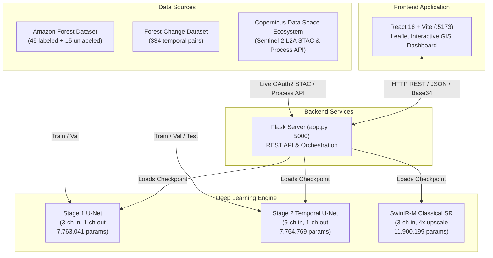
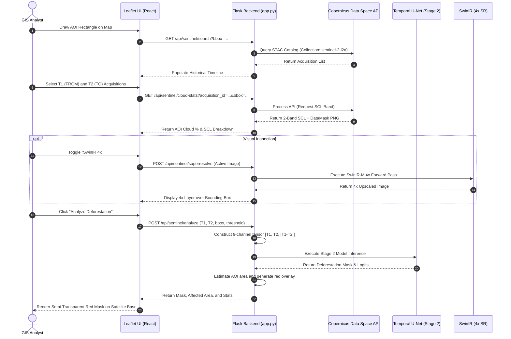

# AI-Based Forest Cover Segmentation and Temporal Deforestation Detection Using Deep Convolutional Networks with Live Copernicus Sentinel-2 GIS Analysis

[](https://pytorch.org/)
[](https://flask.palletsprojects.com/)
[](https://react.dev/)
[](https://leafletjs.com/)
[](https://dataspace.copernicus.eu/)
[](https://github.com/JingyunLiang/SwinIR)

An end-to-end Earth Observation (EO) deep learning and Web GIS platform for automated forest canopy segmentation and bi-temporal deforestation monitoring. Combines PyTorch convolutional networks with live European Space Agency (ESA) Copernicus Sentinel-2 Level-2A satellite data, Scene Classification Layer (SCL) cloud assessment, and SwinIR 4× visual super-resolution.

---

## 📑 Table of Contents
- [Overview](#-overview)
- [Key Features](#-key-features)
- [System Architecture](#-system-architecture)
- [End-to-End Workflow](#-end-to-end-workflow)
- [Deep Learning Pipeline](#-deep-learning-pipeline)
  - [Stage 1: Forest Cover Segmentation](#stage-1-forest-cover-segmentation)
  - [Stage 2: Bi-Temporal Deforestation Detection](#stage-2-bi-temporal-deforestation-detection)
  - [9-Channel Temporal Input Architecture](#9-channel-temporal-input-architecture)
- [Copernicus Sentinel-2 Live GIS Workflow](#-copernicus-sentinel-2-live-gis-workflow)
  - [AOI Drawing & STAC Catalog Query](#aoi-drawing--stac-catalog-query)
  - [SCL-Based Cloud & Obscuration Analysis](#scl-based-cloud--obscuration-analysis)
  - [SwinIR 4× Super-Resolution Visualization](#swinir-4-super-resolution-visualization)
  - [AOI-Based Area Approximation](#aoi-based-area-approximation)
- [Datasets & Class Imbalance Audit](#-datasets--class-imbalance-audit)
- [Empirical Measured Results](#-empirical-measured-results)
  - [Stage 1 Validation Performance](#stage-1-validation-performance)
  - [Stage 2 Held-Out Test Evaluation](#stage-2-held-out-test-evaluation)
  - [Operational Sentinel-2 Demo Inference](#operational-sentinel-2-demo-inference)
- [Implemented vs. Planned Matrix](#-implemented-vs-planned-matrix)
- [Limitations & Scientific Domain Gaps](#-limitations--scientific-domain-gaps)
- [Project Directory Structure](#-project-directory-structure)
- [Installation & Setup](#-installation--setup)
- [Environment Variables](#-environment-variables)
- [Execution Guide](#-execution-guide)
  - [Running the Backend](#1-running-the-backend)
  - [Running the Frontend](#2-running-the-frontend)
- [REST API Reference](#-rest-api-reference)
- [Testing & Verification Suite](#-testing--verification-suite)
- [Reproducibility Notes](#-reproducibility-notes)

---

## 🌍 Overview

Automating deforestation detection from satellite imagery requires overcoming two key obstacles: **severe class imbalance** (deforestation events typically affect $< 5\%$ of land cover in satellite tiles) and **error multiplication in post-classification comparisons** (subtracting independently segmented masks compounds classification errors).

This project addresses these challenges with a validated two-stage machine learning architecture paired with an interactive Web GIS platform:
1. **Stage 1 (Static Canopy Delineation):** A 3-channel convolutional U-Net trained on the Amazon Forest Dataset to segment baseline forest cover.
2. **Stage 2 (Bi-Temporal Change Detection):** A 9-channel Temporal U-Net trained on the Forest-Change dataset that ingests pre-change imagery ($T_1$), post-change imagery ($T_2$), and an explicit absolute difference tensor ($|T_1 - T_2|$) to detect forest loss directly.
3. **Live Earth Observation:** A direct integration with the European Copernicus Data Space Ecosystem to query Sentinel-2 imagery, quantify AOI-specific cloud obscuration using the Scene Classification Layer (SCL), and run live deforestation inference. Live area is an AOI-bounds approximation; benchmark samples and ordinary uploads report pixel counts without physical area.
4. **SwinIR Super-Resolution:** An architecturally isolated Swin Transformer module providing 4× spatial magnification for visual inspection without affecting model inference.

---

## ✨ Key Features

- **Direct Temporal Modeling:** Overcomes the failure modes of post-classification subtraction by processing bi-temporal image pairs through an end-to-end 9-channel architecture.
- **Robust U-Net Spatial Shapes:** Both U-Nets pad only the bottom/right edges to a multiple of 16 and crop logits to the original dimensions, so odd-sized inputs work without changing learned checkpoint weights.
- **Explicit Change Prior:** Ingests the absolute difference tensor $|T_1 - T_2|$ alongside raw RGB channels, giving early convolutional layers a direct inductive bias for spectral change detection.
- **Severe Class Imbalance Mitigation:** Combines Positive-Weighted Binary Cross-Entropy ($w_{\text{pos}} = 19.94$) and Focal Loss ($\gamma = 2.0, \alpha = 0.75$) with per-image Soft Dice Loss to reduce domination by samples with different foreground prevalence.
- **Live Copernicus Data Space Integration:** Authenticated OAuth2 integration querying the Sentinel-2 L2A STAC catalog and retrieving dynamically rendered true-color RGB tiles via the Process API.
- **AOI-Specific Cloud Statistics:** Extracts the 20-meter Scene Classification Layer (SCL) to compute cloud obscuration percentages specifically within the user's drawn bounding box, distinguishing local cloud cover from tile-wide catalog estimates.
- **Client-Side Cloud Mask Overlay:** Generates a cyan-tinted map overlay showing obscured pixels to alert analysts before running inference.
- **SwinIR 4× Super-Resolution Visualization:** Magnifies Sentinel-2 imagery by 4× (from 10 m to 2.5 m pixel grid display) for visual verification, while maintaining strict isolation from the segmentation pipeline.
- **AOI Area Approximation:** For live Sentinel analyses with a valid AOI bounding box, estimates area by dividing the spherical bounding-box area by the prediction pixel count. This approximation does not use per-pixel georeferencing. Unreferenced samples and uploads report pixel counts only.
- **Interactive Web GIS Dashboard:** A React/Leaflet interface featuring five specialized views: Historical GIS Map, Stage 1 Workbench, Stage 2 Workbench, Temporal Swipe Viewer, and Live Analytics.

---

## 🏗️ System Architecture



---

## 🔄 End-to-End Workflow



---

## 🧠 Deep Learning Pipeline

### Stage 1: Forest Cover Segmentation
- **Task:** Single-image binary semantic segmentation of static forest canopy.
- **Model:** Standard convolutional U-Net (`src/model.py`) with 4 downsampling stages (32, 64, 128, 256, 512 channels) and 4 transposed convolution upsampling stages with skip connections.
- **Input:** Single 3-channel RGB image normalized to $[0.0, 1.0]$ ($3 \times 256 \times 256$).
- **Output:** 1-channel probability map thresholded at $\tau = 0.5$.
- **Trainable Parameters:** **7,763,041** parameters.
- **Checkpoint:** `models/best_unet_model.pth` (saved at Epoch 5).

### Stage 2: Bi-Temporal Deforestation Detection
- **Task:** End-to-end detection of forest loss between two temporal acquisitions ($T_1 \to T_2$).
- **Why Direct Modeling Over PCC?** Post-Classification Comparison (independently segmenting $T_1$ and $T_2$ and subtracting masks) produces catastrophic error multiplication under domain shifts, yielding a test IoU of only **0.0026** (0.26%) on the benchmark test set. Direct temporal modeling resolves this by learning joint temporal features end-to-end.
- **Model:** `TemporalUNet` (`src/temporal_model.py`) parameterized with 9 input channels.
- **Trainable Parameters:** **7,764,769** parameters.
- **Checkpoint:** `models/best_temporal_model.pth` (saved at Epoch 21 with validation IoU = 0.5043).

### 9-Channel Temporal Input Architecture
Given pre-change RGB image $\mathbf{I}_{T_1} \in \mathbb{R}^{3 \times H \times W}$ and post-change RGB image $\mathbf{I}_{T_2} \in \mathbb{R}^{3 \times H \times W}$:
1. Compute the pixel-wise absolute spectral difference:
   $$\mathbf{D} = |\mathbf{I}_{T_1} - \mathbf{I}_{T_2}| \in \mathbb{R}^{3 \times H \times W}$$
2. Concatenate along the channel dimension:
   $$\mathbf{X}_{\text{temp}} = \left[ \mathbf{I}_{T_1} \parallel \mathbf{I}_{T_2} \parallel \mathbf{D} \right] \in \mathbb{R}^{9 \times H \times W}$$
   - Channels $0, 1, 2$: Pre-change Red, Green, Blue ($T_1$)
   - Channels $3, 4, 5$: Post-change Red, Green, Blue ($T_2$)
   - Channels $6, 7, 8$: Absolute Spectral Difference $|\Delta \text{R}|, |\Delta \text{G}|, |\Delta \text{B}|$

The explicit difference tensor provides an inductive bias that immediately highlights spectral change candidates in the first convolutional layer, allowing downstream layers to focus on discriminating canopy clearance from seasonal fluctuations.

---

## 🛰️ Copernicus Sentinel-2 Live GIS Workflow

### AOI Drawing & STAC Catalog Query
- Users draw a bounding box rectangle on the Leaflet map.
- The coordinates $[ \text{west}, \text{south}, \text{east}, \text{north} ]$ are normalized using modular antimeridian wrapping ($[-180, 180]$).
- The backend queries the Copernicus Data Space Ecosystem STAC endpoint (`collection: sentinel-2-l2a`) to retrieve available historical acquisitions.

### SCL-Based Cloud & Obscuration Analysis
- **The Problem:** Scene-level cloud cover (`eo:cloud_cover`) measures clouds across the entire $100\text{ km} \times 100\text{ km}$ tile, which often misrepresents conditions in a small local AOI.
- **The Solution:** The backend requests the 20-meter Scene Classification Layer (SCL) via the Sentinel Hub Process API over the exact AOI bounding box.
- **Classification:**
  - **Cloud / Obscured Classes:** 3 (Cloud Shadows), 7 (Unclassified/Low Prob), 8 (Medium Prob Cloud), 9 (High Prob Cloud), 10 (Thin Cirrus).
  - **Clear Classes:** 4 (Vegetation), 5 (Bare Soils), 6 (Water).
- **Interface Warning:** If AOI cloud cover exceeds 20%, an alert warning advises the user that inference accuracy may be degraded.

### SwinIR 4× Super-Resolution Visualization
- **Model:** Pretrained SwinIR-M classical super-resolution network (`models/swinir_x4.pth`, 11.9M parameters, 67.8 MB).
- **Architecture:** 6 Residual Swin Transformer Blocks (RSTB), 6 Swin Transformer Layers per block, embed dimension 180, window size $8 \times 8$, PixelShuffle $4\times$ upsampler.
- **Strict Isolation:** SwinIR is used **exclusively for visual verification** in the GIS map. It is **never fed into the Temporal U-Net**. Live deforestation inference always operates on the original 10-meter Sentinel-2 image.
- **Clarification:** SwinIR scales a $512 \times 512$ image to a $2048 \times 2048$ grid for visualization. This is learned spatial super-resolution, **not physical 2.5-meter satellite sensor measurements**.

### AOI-Based Area Approximation
For live Sentinel analyses, the backend estimates the spherical surface area of the AOI bounding box and divides it by the number of model output pixels. The resulting hectares and square kilometers are approximate because the calculation does not use a raster transform or per-pixel geodesic areas. Benchmark samples and ordinary uploads have no verified georeferencing, so their physical area fields are empty and their results are reported in pixels and percentages.

---

## 📊 Datasets & Class Imbalance Audit

### Benchmark Datasets
1. **Amazon Forest Dataset (Stage 1):**
   - 30 Training images + masks, 15 Validation images + masks, 15 Unlabeled test TIFFs.
   - Raw Mask 2 = Forest (Class 1), Raw Mask 1 = Background (Class 0).
2. **Forest-Change Dataset (Stage 2):**
   - 334 bi-temporal pairs ($480 \times 480$ RGB PNGs): 270 Train, 31 Validation, 33 Test.
   - Any ground-truth change intensity $> 0$ is thresholded as binary deforestation.

### Empirical Pixel Distribution Audit

| Split | Image Pairs | Deforestation Pixels (Positive) | Background Pixels (Negative) | Positive Ratio | Class Imbalance Ratio ($\text{Neg}/\text{Pos}$) |
|---|---|---|---|---|---|
| **Train** | 270 | 844,851 | 16,849,869 | **4.77%** | **19.94 : 1** |
| **Validation** | 31 | 106,999 | 1,924,617 | **5.27%** | **17.99 : 1** |
| **Test** | 33 | 101,274 | 2,061,414 | **4.68%** | **20.35 : 1** |
| **Total** | 334 | 1,053,124 | 20,835,900 | **4.81%** | **19.78 : 1** |

To prevent models from collapsing to all-zero predictions, loss functions apply a positive weight of $w_{\text{pos}} = 19.94$ during training.

---

## 📈 Empirical Measured Results

All metrics are exact values extracted directly from verified evaluation artifacts (`outputs/`).

### Stage 1 Validation Performance
Evaluated on the Amazon Forest Dataset validation split (15 samples, image size $256 \times 256$, threshold $\tau = 0.5$):

| Evaluation Metric | Measured Value | Percentage Form |
|---|---|---|
| **Mean IoU (Jaccard Index)** | `0.8385551377629015` | **83.86%** |
| **Mean Dice (F1 Score)** | `0.9121892735653608` | **91.22%** |
| **Mean Precision** | `0.9220567645670562` | **92.21%** |
| **Mean Recall** | `0.9025307424186895` | **90.25%** |
| **Mean Pixel Accuracy** | `0.9093271891276041` | **90.93%** |

*Artifact Source:* `outputs/evaluation_metrics.json`, `outputs/evaluation_report.txt`

### Stage 2 Held-Out Test Evaluation
Evaluated on the Forest-Change dataset independent test split (**33 pairs, 2,162,688 total pixels**, threshold $\tau = 0.5$):

| Evaluation Metric | Measured Value | Percentage Form |
|---|---|---|
| **Global IoU** | `0.3827710357242621` | **38.28%** |
| **Global Dice (F1 Score)** | `0.5536289462756585` | **55.36%** |
| **Global Precision** | `0.6412156189881973` | **64.12%** |
| **Global Recall** | `0.4870944171258171` | **48.71%** |
| **Global Pixel Accuracy** | `0.9632189201586174` | **96.32%** |

#### Pixel Confusion Matrix Counts
- **True Positives (TP):** `49,330` pixels
- **False Positives (FP):** `27,602` pixels
- **False Negatives (FN):** `51,944` pixels
- **True Negatives (TN):** `2,033,812` pixels
- **Total Ground-Truth Deforestation:** `101,274` pixels (**4.6828%**)
- **Total Predicted Deforestation:** `76,932` pixels (**3.5572%**)

*Artifact Source:* `outputs/temporal/temporal_test_results.json`, `outputs/temporal/temporal_test_report.txt`

### Operational Sentinel-2 Demo Inference
When running inference on live Sentinel-2 imagery via `/api/sentinel/analyze`, the system outputs:
- Predicted deforestation pixel count and percentage.
- Approximate hectares and square kilometers from the live AOI bounding box; sample and upload workflows report pixels only.
- **Important Distinction:** Live Sentinel-2 queries **do not have ground-truth masks**. Therefore, IoU, Dice, Precision, and Recall are not reported for live queries. Benchmark metrics apply strictly to the held-out test datasets.

---

## ⚖️ Implemented vs. Planned Matrix

| Capability / Feature | Status | Implementation Details & Architectural Notes |
|---|:---:|---|
| **Stage 1 U-Net Forest Segmentation** | ✅ Implemented | 3-channel U-Net; 7.76M parameters; evaluated on Amazon Forest Dataset. |
| **Stage 2 Temporal Change Detection** | ✅ Implemented | 9-channel Temporal U-Net $[T_1, T_2, \|T_1 - T_2\|]$; evaluated on Forest-Change test set. |
| **Extreme Class Imbalance Training** | ✅ Implemented | Weighted BCE ($w_{\text{pos}} = 19.94$) + Focal Loss ($\gamma = 2.0$) + Soft Dice Loss. |
| **Copernicus OAuth2 & STAC Search** | ✅ Implemented | Live token generation; queries `sentinel-2-l2a` catalog with bbox filtering. |
| **Sentinel Hub Process API Previews** | ✅ Implemented | Custom evalscript rendering calibrated true-color RGB PNG tiles. |
| **AOI-Specific SCL Cloud Statistics** | ✅ Implemented | Queries 20 m SCL band; classifies classes $\{3, 7, 8, 9, 10\}$ as cloud/obscured. |
| **Client-Side Cloud Mask Overlay** | ✅ Implemented | Dynamic cyan overlay showing obscured pixels in the Leaflet map. |
| **SwinIR 4× Super-Resolution** | ✅ Implemented | SwinIR-M classical SR ($4\times$); strictly isolated visualization tool. |
| **AOI-Based Area Approximation** | ✅ Implemented with limits | Live Sentinel results estimate area from the AOI bounding box; this is not per-pixel georeferenced measurement. Samples and uploads have no physical area estimate. |
| **Interactive Leaflet Web GIS** | ✅ Implemented | React 18 interface with AOI drawing, swipe comparisons, and metric dashboard. |
| **Automatic Cloud Masking During Inference** | ⏳ Planned | Cloudy pixels are currently passed into the model; masking them out is planned. |
| **Domain Adaptation for Sentinel-2** | ⏳ Planned | Fine-tuning the Temporal U-Net directly on annotated Sentinel-2 L2A tiles. |
| **Disturbance Driver Classification** | ⏳ Planned | Multi-class categorization (e.g., wildfire vs. logging vs. pasture). |
| **Multi-Date Temporal Sequences (> 2 dates)**| ⏳ Planned | Recurrent/Transformer sequence modeling across continuous time series. |
| **Physical 2.5 m Satellite Imagery** | ❌ Not Planned | SwinIR output is generative super-resolution, not physical sensor data. |

---

## ⚠️ Limitations & Scientific Domain Gaps

1. **Domain Shift Between Benchmark & Live Imagery:** The Stage 2 model was trained on the Forest-Change dataset, which has different radiometric and sensor characteristics than live Sentinel-2 L2A surface reflectance. While the model detects prominent canopy loss on Sentinel-2, test set metrics (38.28% IoU) do not directly transfer to live scenes without domain adaptation.
2. **Cloud Pixels Are Not Excluded From Inference:** In the current release, cloudy pixels in live Sentinel-2 scenes are passed to the Temporal U-Net without being masked out. Clouds and cloud shadows can cause false positive detections. Users should verify that AOI cloud cover is $< 10\%$ before running analysis.
3. **Seasonal Phenology Shifts:** Significant wet-to-dry season reflectance variations can trigger false change detections along forest borders. Multi-temporal baseline subtraction is planned to address this.
4. **SwinIR is a Visualization Tool Only:** SwinIR increases visual pixel density by 4×, but does not synthesize new physical sensor measurements. It is never used as input to the segmentation models.

---

## 📁 Project Directory Structure

```
Deforestation-Detection-from-Satellite-Images/
├── app.py                      # Production Flask REST API (Port 5000)
├── backend/
│   └── main.py                  # Separate FastAPI inference service (legacy/optional; not used by Vite)
├── PROJECT_REPORT.md           # Formal 27-section technical engineering report
├── README.md                   # System documentation and developer guide
├── package.json                # Root package configuration
├── vite.config.js              # Vite bundler proxy configuration
│
├── frontend/                   # React 18 SPA Source Code
│   ├── src/
│   │   ├── App.jsx             # Main application shell with 5 tab views
│   │   ├── GisMap.jsx          # Leaflet GIS interface with AOI drawing & overlays
│   │   ├── index.css           # Design tokens, typography, and layout styles
│   │   └── main.jsx            # React DOM entry point
│   ├── package.json            # Frontend dependencies (Leaflet, Lucide, Vite)
│   └── vite.config.js          # Proxies /api requests to http://127.0.0.1:5000
│
├── src/                        # Core PyTorch Machine Learning Engine
│   ├── model.py                # Stage 1 U-Net architecture (3-ch in, 1-ch out)
│   ├── temporal_model.py       # Stage 2 Temporal U-Net (9-ch in, 1-ch out)
│   ├── dataset.py              # Amazon Forest Dataset loader & augmentations
│   ├── temporal_dataset.py     # Forest-Change dataset loader (6-ch and 9-ch)
│   ├── metrics.py              # Loss functions & confusion matrix calculations
│   ├── train.py                # Stage 1 training script
│   ├── train_temporal.py       # Stage 2 initial training script
│   ├── train_temporal_v2.py    # Stage 2 experimental training pipeline (A, B, C)
│   ├── evaluate.py             # Stage 1 validation evaluation script
│   ├── evaluate_temporal.py    # Stage 2 held-out test evaluation script
│   └── swinir/                 # SwinIR Super-Resolution Sub-Package
│       ├── network_swinir.py   # Official SwinIR neural network architecture
│       ├── swinir_inference.py # Inference wrapper with reflection padding
│       └── __init__.py         # Package exports
│
├── models/                     # Saved Model Weights Checkpoints
│   ├── best_unet_model.pth     # Stage 1 U-Net checkpoint (93.3 MB, Epoch 5)
│   ├── best_temporal_model.pth # Stage 2 Temporal U-Net (31.1 MB, Epoch 21)
│   └── swinir_x4.pth           # SwinIR-M classical SR checkpoint (67.8 MB)
│
├── data/                       # Datasets
│   ├── Amazon Forest Dataset/  # Stage 1 dataset (Training, Validation, Test)
│   └── Forest-Change/          # Stage 2 dataset (270 train, 31 val, 33 test)
│
├── outputs/                    # Evaluation Reports & Metrics
│   ├── evaluation_metrics.json # Stage 1 validation metrics (IoU: 0.8386)
│   ├── evaluation_report.txt   # Stage 1 summary report
│   ├── temporal/
│   │   ├── temporal_test_results.json # Stage 2 test metrics (IoU: 0.3828)
│   │   └── temporal_test_report.txt   # Stage 2 summary report
│   └── experiments/            # Training logs and checkpoint artifacts
│
└── tests & scripts/
    ├── smoke_test.py           # Dataloader, model, and loss smoke test suite
    ├── test_cloud_stats.py     # Automated unit tests for SCL cloud endpoint
    ├── verify_swinir.py        # Verification script for SwinIR super-resolution
    └── audit_stats.py          # Pixel-level class imbalance audit script
```

---

## ⚙️ Installation & Setup

### Prerequisites
- **Python:** 3.10 to 3.14 (Verified operational on Python 3.14)
- **Node.js:** v18.0.0 or higher
- **RAM:** Minimum 8 GB (16 GB recommended for SwinIR inference)

### 1. Clone the Repository
```bash
git clone https://github.com/vikaskmalipatil/Deforestation-Detection-from-Satellite-Images.git
cd "Deforestation-Detection-from-Satellite-Images"
```

### 2. Configure Python Virtual Environment
On Windows PowerShell:
```powershell
python -m venv venv
.\venv\Scripts\Activate.ps1
pip install --upgrade pip
pip install torch torchvision --index-url https://download.pytorch.org/whl/cpu
pip install flask flask-cors Pillow opencv-python numpy pandas matplotlib requests timm einops
```

### 3. Install Frontend Dependencies
```powershell
cd frontend
npm install
cd ..
```

### 4. Verify Model Checkpoints
Ensure the required model weights exist in `models/`:
- `models/best_unet_model.pth` (Stage 1 U-Net)
- `models/best_temporal_model.pth` (Stage 2 Temporal U-Net)
- `models/swinir_x4.pth` (SwinIR-M 4× Classical Super-Resolution)

*To obtain the SwinIR checkpoint, download `001_classicalSR_DF2K_s64w8_SwinIR-M_x4.pth` from the [official SwinIR repository](https://github.com/JingyunLiang/SwinIR/releases) and save it to `models/swinir_x4.pth`.*

---

## 🔐 Environment Variables

Create a `.env` file in the project root or configure your shell environment with your Copernicus Data Space Ecosystem credentials:

```bash
# Copernicus Data Space Ecosystem OAuth2 Credentials
SENTINEL_CLIENT_ID="your_copernicus_client_id_here"
SENTINEL_CLIENT_SECRET="your_copernicus_client_secret_here"

# API Base Endpoints (Defaults configured in app.py)
SENTINEL_BASE_URL="https://sh.dataspace.copernicus.eu/api/v1"
SENTINEL_TOKEN_URL="https://identity.dataspace.copernicus.eu/auth/realms/CDSE/protocol/openid-connect/token"
```

*Note: Free Copernicus credentials can be created at [dataspace.copernicus.eu](https://dataspace.copernicus.eu/). Without configured credentials and network access, live Sentinel-2 search and imagery are unavailable; Stage 1, Stage 2 sample pairs, and image uploads remain available.*

### Stage 2: Live Sentinel-2 or Local Imagery

In the Stage 2 workbench, choose **Choose AOI and dates on GIS Map** to open the existing Interactive GIS Map. Draw an AOI, search Sentinel-2 acquisitions over a date range, set an earlier acquisition as **FROM / T1** and a later one as **TO / T2**, then run **Analyze Deforestation**. The map retrieves both images for the same AOI and sends them to the existing `/api/sentinel/analyze` endpoint, which runs the trained 9-channel Temporal U-Net. AOI cloud statistics are shown when available; scenes with substantial cloud cover should be avoided. Missing credentials, acquisitions, or network access are reported as unavailable rather than replaced with sample imagery.

Pre-loaded temporal pairs and manual T1/T2 uploads remain alternatives in Stage 2. Uploaded images must be co-registered to the same geographic footprint and have identical dimensions; the application can validate dimensions, but cannot infer geospatial alignment from ordinary image files. Inference resizes both images to 256 × 256, converts RGB values to [0, 1], and constructs `[T1 RGB, T2 RGB, |T1 - T2|]`. Live Sentinel-2 results are indicative: the model was trained on a different dataset and has a domain gap, as disclosed with the result.

---

## 🚀 Execution Guide

### 1. Running the Backend
Start the Flask application server on port 5000:
```powershell
.\venv\Scripts\python.exe app.py
```
Expected output:
```
[OK] Loaded Stage 1 U-Net from models/best_unet_model.pth
[OK] Loaded Stage 2 Temporal U-Net from models/best_temporal_model.pth
[START] Deforestation Detection GIS Web Server running on http://127.0.0.1:5000
```

### 2. Running the Frontend
In a separate terminal, start the Vite development server:
```powershell
cd frontend
npm run dev
```
Open your browser to `http://localhost:5173`. The Vite development server automatically proxies all `/api` requests to the Flask backend at `http://127.0.0.1:5000`.

---

## 🔌 REST API Reference

The Flask backend provides 13 operational REST endpoints:

| Endpoint Route | Method | Required Parameters / Payload | Description & Response Summary |
|---|:---:|---|---|
| `/api/sentinel/status` | `GET` | None | Returns configuration status and masked preview of Copernicus client credentials. |
| `/api/sentinel/info` | `GET` | None | Returns metadata regarding satellite resolution (10 m GSD) and ingested bands (B04, B03, B02). |
| `/api/sentinel/search` | `GET` | `bbox`, `from`, `to`, `max_cloud` | Queries the Copernicus STAC catalog; returns a sorted array of historical acquisitions. |
| `/api/sentinel/preview` | `GET` | `acquisition_id`, `bbox`, `width`, `height` | Queries the Process API; returns a true-color RGB base64-encoded PNG preview. |
| `/api/sentinel/cloud-stats` | `GET` | `acquisition_id`, `bbox`, `resolution` | Retrieves the 20 m SCL band; returns AOI cloud %, clear %, and a breakdown by SCL class. |
| `/api/sentinel/analyze` | `POST` | JSON: `image_before`, `image_after`, `bbox`, `threshold` | Executes Stage 2 inference; returns mask/overlay, pixel metrics, and approximate AOI-based area when a valid bbox is supplied. |
| `/api/sentinel/superresolve` | `POST` | JSON: `image` (base64) | Executes SwinIR 4× super-resolution; returns a 4× enlarged base64-encoded PNG. |
| `/api/sentinel/superresolve/status` | `GET` | None | Checks whether the `models/swinir_x4.pth` checkpoint is available on disk. |
| `/api/gis/regions` | `GET` | None | Returns regions with verified spatial metadata; currently empty because bundled samples have no georeferenced region metadata. |
| `/api/samples` | `GET` | None | Returns lists of available local dataset samples for Stage 1 and Stage 2 testing. |
| `/api/predict/stage1` | `POST` | Form: `sample_path` or `file`, `threshold` | Executes Stage 1 U-Net segmentation; returns forest canopy mask and pixel area statistics. |
| `/api/predict/stage2` | `POST` | Form: `sample_id` or `files`, `threshold` | Executes Stage 2 Temporal U-Net inference; returns deforestation mask and pixel metrics. |
| `/api/metrics` | `GET` | None | Returns raw JSON validation and test evaluation metrics for the UI dashboard. |

---

## 🧪 Testing & Verification Suite

The tracked tests cover core model/data regressions plus Sentinel and super-resolution integrations:

### 1. Focused ML regression tests
Verifies U-Net shape handling and gradients, six/nine-channel temporal inputs, image-mask alignment, metric edge cases, and loss behavior:
```powershell
.\venv\Scripts\python.exe -m unittest tests.test_ml_core -v
```
Run the available offline tests and optional integrations together with `python -m unittest tests.test_ml_core test_stage2_uploads test_cloud_stats test_sen2naip -v`. The Sentinel cloud integration test skips its live request when credentials are absent or the external service is unavailable. Some root-level `test_*.py` files are manual scripts that call a separately running server and should not be included in automated discovery.

### 2. SCL Cloud Statistics Tests
Tests parameter validation, Process API integration, and cloud percentage calculations:
```powershell
.\venv\Scripts\python.exe test_cloud_stats.py
```
*Expected output: `Ran 4 tests ... OK`*

### 3. SwinIR Super-Resolution Verification
Verifies model checkpoint loading, padding logic, output dimensions ($4H \times 4W$), and RGB channel integrity:
```powershell
.\venv\Scripts\python.exe verify_swinir.py
```

### 4. Stage 2 Test Benchmark Evaluation
Re-runs evaluation across all 33 test pairs in the Forest-Change dataset to reproduce reported metrics:
```powershell
.\venv\Scripts\python.exe src/evaluate_temporal.py
```

---

## 🔬 Reproducibility Notes

- **Random Seeds:** Dataset splits and spatial augmentations use a fixed seed of `42` (`torch.manual_seed(42)`, `random.seed(42)`).
- **Evaluation Threshold:** All reported Stage 1 and Stage 2 benchmark metrics are evaluated at a standard decision threshold of $\tau = 0.5$.
- **Tensor Normalization:** Images are normalized to $[0.0, 1.0]$ via division by $255.0$. Image difference is computed as `torch.abs(t1 - t2)`.
- **Checkpoint Remapping:** Earlier experimental runs named upsampling blocks `cu1` through `cu4`. The model loader in `app.py` automatically maps these to `conv_up1` through `conv_up4` for seamless checkpoint loading.
- **Frontend Build:** The React application compiles into `dist/` via `npm run build` using Vite 5.4.
